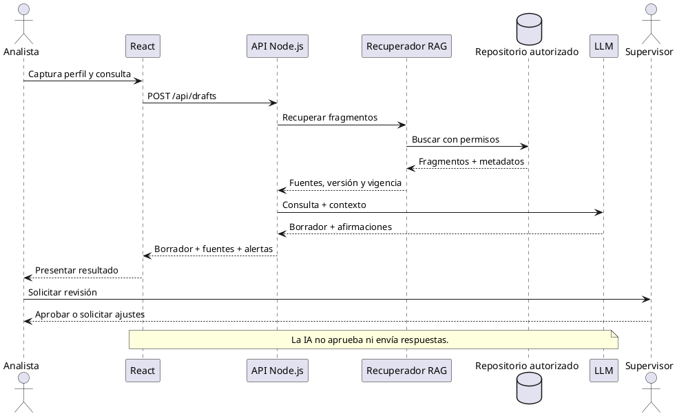
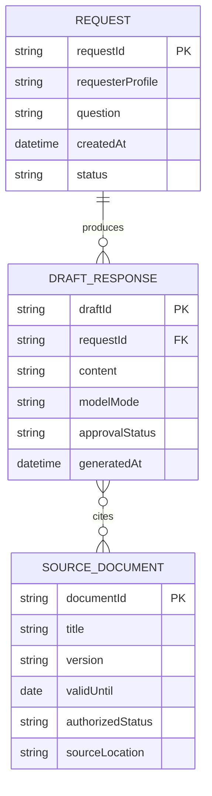
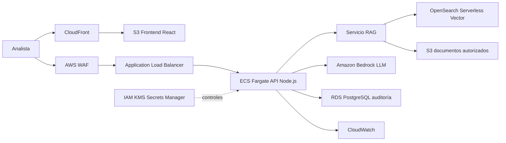

# Diagramas

## Secuencia PlantUML

## Entidades Mermaid

## Arquitectura tentativa AWS

Arquitectura de referencia no desplegada; validar región, privacidad, seguridad y costos. Para PoC no desplegar todos los servicios hasta validar valor.