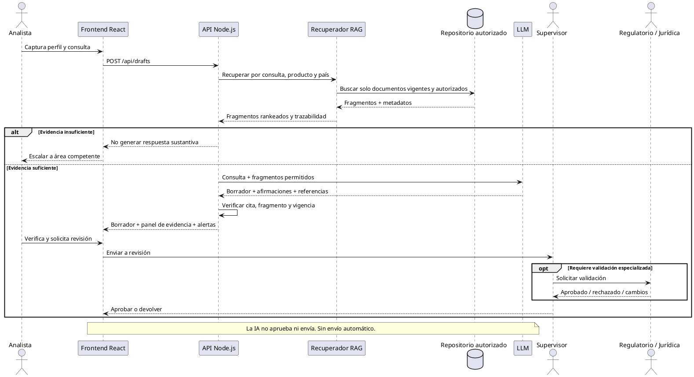
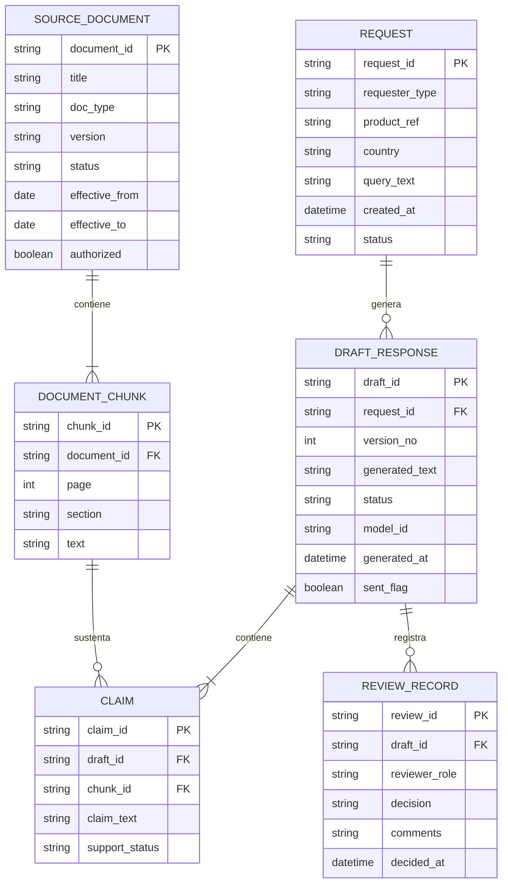
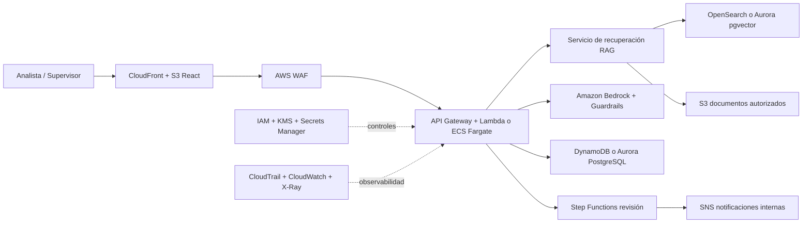

# Diagramas y modelo lógico — PoC A08

## 1. Secuencia objetivo (PlantUML)

## 2. Entidades esenciales y entidades de soporte
Las tres entidades esenciales solicitadas para el MVP son `Request`, `SourceDocument` y `DraftResponse`. Para implementar trazabilidad por afirmación y auditoría se agregan tres entidades de soporte: `DocumentChunk`, `Claim` y `ReviewRecord`.

## 3. Arquitectura tentativa AWS

**Nota:** alternativas como Lambda/ECS, DynamoDB/Aurora y OpenSearch/pgvector requieren selección; no se despliegan todas a la vez. Arquitectura de referencia no implementada. Validar residencia de datos, región, costos, seguridad y sistemas existentes.

## 4. Estado real del prototipo
El código publicado implementa una interfaz React, una API Node.js con `GET /health` y `POST /api/drafts`, validación básica y una respuesta determinista DEMO con fuente ficticia, alertas y aprobación pendiente. No implementa el flujo RAG, un LLM real, las seis entidades persistidas ni workflow de aprobación.
